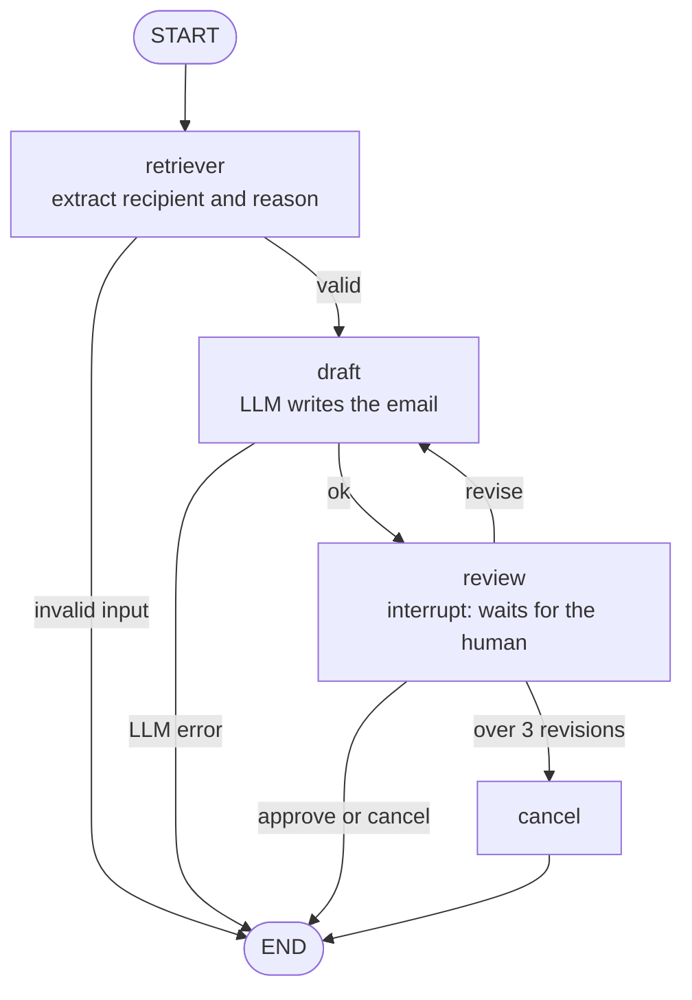

# AI Email assistant


Describe an email in plain language. Quill extracts the recipient and intent, drafts it with an LLM, and **pauses for your approval** before anything is sent. Emails go out from the user's own Google account, or the user can copy the draft.

**Live demo:** https://ai-based-email-agent-7u4qk6a3oa-el.a.run.app

<!-- screenshot / GIF here -->

## How it works



Sending happens in the UI layer **after** approval, so OAuth tokens never enter graph state or checkpoints. Regenerate the diagram with `python show_graph.py`.

## What it demonstrates
- **LangGraph human-in-the-loop**: `interrupt()` and `Command(resume=...)` for approve, edit, revise and cancel
- **Checkpointing** (SQLite) with a per-session `thread_id`
- **Conditional routing** with a capped revision loop and error exits
- **Structured output** (Pydantic) with retry and fallback between `json_schema` and function calling
- **Google OAuth 2.0** with the minimal `gmail.send` scope
- **Observability** with LangSmith traces
- **Delivery**: tests, Docker, GitHub Actions CI/CD, Google Cloud Run

## Security design
- No shared credentials: mail is sent from the signed-in user's own account (draft-only mode otherwise)
- The OAuth scope can send mail but cannot read the inbox
- OAuth `state` is HMAC-signed and expires after 15 minutes; sign-out revokes the token
- Secrets live in Secret Manager / env vars, never in git (`.env` and `secrets.toml` are ignored)
- Per-session AI request limit to protect the shared LLM key
- GitHub deploys use keyless Workload Identity Federation (no JSON keys)

## Run locally
```bash
python -m venv .venv && .venv\Scripts\activate      # Mac/Linux: source .venv/bin/activate
pip install -r requirements.txt
cp .env.example .env                                  # add GROQ_API_KEY
cp .streamlit/secrets.toml.example .streamlit/secrets.toml
streamlit run app.py
python -m pytest -v
```

## Google OAuth setup
1. Google Cloud Console: enable the **Gmail API**.
2. **OAuth consent screen**: External, add scopes `openid`, `userinfo.email`, `userinfo.profile`, `gmail.send`, and add yourself under **Test users**.
3. Create an **OAuth client ID** (Web application) with redirect URIs `http://localhost:8501` and your deployed URL.

While the consent screen is in *Testing*, only listed test users can sign in. Everyone else still gets draft-only mode. Opening sign-in to everyone requires Google's verification because `gmail.send` is a sensitive scope.

## Docker
```bash
docker build -t email-assistant .
docker run -p 8080:8080 --env-file .env email-assistant
```

## Deploy to Google Cloud Run
One-time setup in Cloud Shell (`deploy/setup_gcp.sh` then `deploy/first_deploy.sh`). After that, every push to `main` runs the tests and deploys through `.github/workflows/cd.yml`.

| Workflow | When | What |
|---|---|---|
| `ci.yml` | every push and PR | install, run pytest |
| `cd.yml` | push to `main` | test, build image, push to Artifact Registry, deploy to Cloud Run |

The service scales to zero (no idle cost), so the first request after a quiet period can take a few seconds.

## Project structure
```
app.py              Streamlit UI
graph.py            LangGraph workflow
gmail_service.py    Google OAuth + Gmail API + mailto fallback
show_graph.py       regenerates docs/graph.mmd and docs/graph.png
tests/              pytest suite
deploy/             Cloud Run setup scripts
.github/workflows/  CI and CD
```
